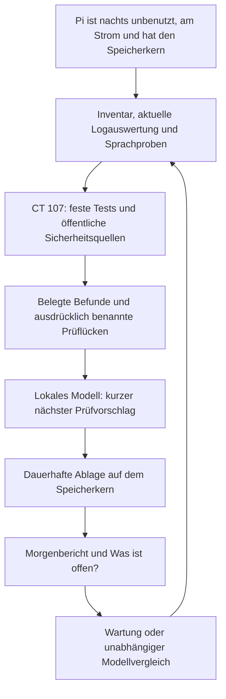

# Proximus: begründete Nachtarbeit und überprüfbare Verbesserungen

Die Nachtarbeit soll drei Fragen beantworten: Was wurde tatsächlich geprüft?
Was braucht Aufmerksamkeit? Was ist der nächste begründete Schritt? Ein lokales
Modell hilft beim Formulieren von Vorschlägen. Messungen, Versionsabgleiche und
gespeicherte Befunde liefern die Fakten. Eine plausible Modellantwort beweist
weder die Behebung eines Fehlers noch die Qualität eines neuen Modells.

Diese Beschreibung unterscheidet den implementierten Nachtlauf von weiteren
Ausbaustufen. Einrichtung und Sprachbefehle stehen in [nightwatch.md](nightwatch.md).

## Ablauf und Ressourcen

Ein Nachtlauf ist auf 20 Minuten begrenzt. Die lokale Modellantwort hat ein
kleines Ausgabelimit; bei Modellfehlern erfolgt keine kostenpflichtige
Ersatzanfrage. Internetabfragen verwenden feste öffentliche Schnittstellen.
OpenRouter wird im Nachtpfad nicht aufgerufen. Lokale Verarbeitung benötigt
weiterhin Rechenzeit und Strom. Ein fehlgeschlagener Lauf wird erst in der
nächsten Nacht wiederholt, statt die Nacht mit wiederholten Versuchen zu füllen.

Bedienung, Alarme und Sprachausgabe haben Vorrang. Bereits laufende native
Vosk-/Piper-Aufrufe können erst an ihrer nächsten Prüfgrenze enden. Deshalb
gehört ein späterer langer Trainingslauf in einen getrennten, abbrechbaren
Prozess mit CPU-, RAM- und Temperaturgrenzen. Der aktuelle Nachtlauf startet
keinen solchen Trainingsprozess. Auf CT 107 darf Training dem laufenden
Qwen-Modell und dem Sprachdienst nicht den Arbeitsspeicher entziehen.

## Sicherheitsmeldungen müssen zur Installation passen

| Frage | Erforderlicher Nachweis |
|---|---|
| Ist die Technik vorhanden? | Tatsächlich installierte Paketversion, Git-Commit oder nachvollziehbarer Binärhash; für Hardware die konkrete Modellkennung. |
| Trifft die Meldung diese Version? | Passender Hersteller, Produkt, Distribution und Versionsbereich. Debian-Vergleiche berücksichtigen Distributionspatches. |
| Sind die Voraussetzungen erfüllt? | Beispielsweise aktivierte Funktion, erreichbarer Dienst oder betroffene Hardware. Unbekannte Voraussetzungen bleiben als offene Prüfung erhalten. |
| Wird die Lücke bereits ausgenutzt? | Ein passender CVE-Eintrag im offiziellen CISA-Katalog erhöht die Priorität. |
| Ist die Korrektur wirksam? | Erneuter vollständiger Versionsabgleich; bei Kernel-/Firmwarewechseln zusätzlich der tatsächlich laufende Stand nach einem nötigen Neustart. |

Implementiert sind Debian- und OSV-Abgleiche sowie eine zusätzliche Gewichtung
durch den [CISA-Katalog bekannter ausgenutzter Schwachstellen](https://www.cisa.gov/known-exploited-vulnerabilities-catalog).
Die Abfrage verwendet den offiziellen JSON-Feed, bei dessen Ausfall den
[offiziellen Spiegel von CISA](https://github.com/cisagov/kev-data). Der Cache
gilt sechs Stunden. Nur bereits zur erfassten Installation gefundene CVEs
werden angereichert. Eine häufig diskutierte CVE allein erzeugt keinen Befund.

Bekannte Ausnutzung erhält Priorität 0 und wird im Sprachabruf hervorgehoben.
Das bedeutet nicht, dass Proximus angegriffen wurde. Ist der Katalog nicht
erreichbar, lautet das Ergebnis „Priorisierung ungeprüft“. Ein bereits
gespeicherter Ausnutzungshinweis geht bei einem späteren Quellenfehler nicht
verloren. Die US-Behördenfristen im Katalog bestimmen keine automatische
Updatefrist für diese private Installation.

Herstellerprüfungen benötigen eigene strukturierte Adapter. Sie sind noch
offen. Zwei Beispiele zeigen, warum eine bloße Internetzusammenfassung nicht
genügt:

- Die [Raspberry-Pi-Sicherheitsseite](https://www.raspberrypi.com/security/)
  beschreibt CVE-2026-13199 für Raspberry Pi 5 und Compute Module 5. Daraus
  folgt kein Befund für den Pi Zero 2 W. Die dort veröffentlichte Prüfung
  angebotener Betriebssystemabbilder ersetzt auch kein Inventar dieses Pi.
- Die [Proxmox-Sicherheitshinweise](https://forum.proxmox.com/threads/proxmox-virtual-environment-security-advisories.149331/)
  nennen betroffene Produkte und Paketstände. Ein Export aus CT 107 belegt
  nicht die installierten Pakete und den laufenden Kernel des Proxmox-Hosts.

Ein Host muss deshalb ein eigenes Inventar liefern. Der implementierte Import
prüft sowohl die Dateizeit als auch den Erfassungszeitpunkt im Inhalt: höchstens
24 Stunden alt, maximal zwei Minuten in der Zukunft. Eine alte Datei wird durch
erneutes Kopieren nicht aktuell. Höchstens acht zusätzliche, eindeutig benannte
Systeme werden angenommen; fehlende und doppelte Angaben erzeugen Prüflücken.
Ein späterer Adapter muss Hardwarekennung und aktiven Kernel separat erfassen.
Bei einem geänderten Herstellerformat soll er „ungeprüft“ melden.

## Logs liefern Hinweise und einen zeitlichen Verlauf

Ja: Die vorhandene Logüberwachung liest das eigene Dienstjournal und die
Systemwarnungen der letzten 24 Stunden auf Pi und CT 107, alle 30 Minuten.
Der Nachtlauf übernimmt feste Fehlercodes, Häufigkeiten und Zeitpunkte.
Rohe Logzeilen werden nicht an öffentliche Quellen geschickt. Die externe
Lösungssuche verwendet vorgegebene technische Begriffe.

Der neue Prüfzeitpunkt muss höchstens eine Stunde alt sein. Fehlender Zugriff,
eine unvollständige Auswertung oder ein alter Snapshot können einen offenen
Logbefund nicht erledigen. Eine erkannte Wiederherstellung nach dem letzten
Fehler darf ihn erledigen; das bloße Alter einer Fehlermeldung genügt nicht.
Die gespeicherte Beobachtungszeit zeigt, wann der Fehler wirklich auftrat.

Weitere Trendanalysen sind sinnvoll: Häufen sich Speicherabbrüche nach einem
Update? Steigt die Erkennungsdauer bei hoher Last? Solche Korrelationen wären
Prüfvorschläge. Ein kontrollierter Vergleich muss die vermutete Ursache erst
bestätigen. Diese Trendanalyse ist noch nicht implementiert.

## Sprachaufnahmen verbessern unterschiedliche Komponenten

| Komponente | Brauchbare Daten und Nachweis |
|---|---|
| Weckwort | Bestätigte „Proximus“-Aufnahmen aus mehreren Sitzungen sowie lange Negativaufnahmen ohne Weckwort; Treffer und Fehlaktivierungen auf unbekanntem Material messen. |
| Sprechererkennung | Bestätigte Referenzen des jeweiligen Sprechers und Vergleichsstimmen; getrennt vom Weckwort bewerten. |
| Spracherkennung | Audio mit verlässlicher manueller Transkription; Fehlerrate bei gleicher Testmenge vergleichen. |
| Sprachausgabe | Problematische Wörter und Aussprachebeispiele; Verständlichkeit und Laufzeit prüfen. Audioaufnahmen allein sind kein fertiger TTS-Trainingsbestand. |
| Qwen | Kuratierte Texte, gewünschte Antworten und unabhängige Prüfaufgaben. Zunächst Wissensabruf und Anweisungen verbessern; ein Feintuning braucht passende Hardware und eine eigene Evaluation. |

Die [openWakeWord-Dokumentation](https://github.com/dscripka/openWakeWord)
beschreibt sowohl Treffer auf realen Positivaufnahmen als auch Fehlaktivierungen
auf verschiedenem Negativmaterial als relevante Bewertungsgrößen. Viele ähnliche
Positivclips allein beantworten die zweite Frage nicht.

### Implementierte Vorbereitung der Weckwortdaten

Die Nachtprüfung untersucht höchstens 200 WAV-Dateien auf Format, Länge,
Signal und starkes Clipping. Identischer PCM-Inhalt zählt durch SHA-256 genau
einmal. Ein kopierter Clip kann nicht zugleich in Training und Test landen.
Das ist eine technische Qualitätsprüfung; sie bestätigt nicht automatisch,
dass der Sprecher wirklich das gewünschte Weckwort gesagt hat.

Bekannte Aufnahme-Dateinamen enthalten eine Sitzungskennung. Deren stabiler
Hash teilt die Sitzung vollständig Training, Validierung oder Test zu, bevor
spätere Augmentation erfolgt. Neue Sitzungen verschieben vorhandene Sitzungen
nicht. Dateien ohne bekannte Sitzung bleiben unzugeordnet. Ein formal
vorbereiteter Positivsplit benötigt mindestens 20 eindeutige Clips aus drei
Sitzungen, davon mindestens 10 für Training, 5 für Validierung und 5 für Test.
Die Hashverteilung kann zusätzliche Sitzungen erforderlich machen. Unterschiedliche
Sitzungen beweisen noch keine Vielfalt von Tagen, Räumen und Abständen.

Manifest und vollständiger Aufnahmebestand bleiben auf dem Speicherkern.
Für die Trainingsplanung erhält der Nachtserver nur die Anzahl eindeutiger
Clips, Duplikate und Sitzungen sowie die formale Bereitschaft des Splits.
Zusätzlich geht eine begrenzte Audioprobe über das private LAN an CT 107 für
den lokalen Erkennungstest. Keine Aufnahme geht an Rechercheanbieter.
Negativmaterial bleibt für einen Trainingsvergleich zusätzlich erforderlich.

**Offene Integration:** Der vorhandene Trainer wählt derzeit seine Checkpoints
anhand der eigenen `positive_real_test`-Daten. Diese Daten sind damit
Validierungsdaten. Sie dürfen nicht als unabhängiger Abschlusstest ausgegeben
werden. Der neue Sitzungsplan muss erst in den Trainer eingebaut werden, mit
einem getrennten, bei Training und Schwellenauswahl unbenutzten Abschlusstest.

### Implementierte Prüfung gemessener Kandidatenberichte

`scripts/review-wakeword-candidate.py` prüft zwei bereits gemessene Berichte
gegen das Manifest. Es trainiert kein Modell und erzeugt die Messungen nicht
selbst. Jeder Bericht benötigt diese Felder:

| Feld | Bedeutung |
|---|---|
| `dataset_id`, `test_sha256` | Manifestkennung und sortierte Hashliste exakt derselben zurückgehaltenen Testclips. |
| `measured_on`, `selection_used_test` | `pi-zero-2-w` und `false`; der Abschlusstest wurde nicht zur Auswahl verwendet. |
| `positive_count`, `true_positives`, `recall` | Clipanzahl, tatsächlich erkannte Clips und dazu passende Trefferquote. |
| `negative_dataset_sha256`, `negative_hours`, `false_activations` | Identischer Negativbestand, dessen Dauer und gezählte Fehlaktivierungen. |
| `model_sha256`, `threshold`, `latency_p95_ms` | Nachvollziehbare Modelldatei, verwendeter Schwellwert und auf dem Pi gemessene 95-Prozent-Latenz. |

Die Projektgrenzen für eine anschließende menschliche Prüfung sind:

- Mindestens 30 unbekannte Positivclips und zehn Stunden identisches Negativmaterial.
- Mindestens 90 Prozent Treffer; höchstens ein Prozentpunkt schlechter als der Bestand.
- Höchstens 0,5 Fehlaktivierungen pro Stunde und keine Verschlechterung gegenüber dem Bestand.
- Höchstens 80 Millisekunden 95-Prozent-Latenz und höchstens zehn Prozent langsamer als der Bestand.
- Ein messbarer Vorteil: mindestens zwei Prozentpunkte mehr Treffer oder mindestens 0,05 Fehlaktivierungen pro Stunde weniger.

Das Ergebnis lautet höchstens `review_ready: true`; `activated` bleibt immer
`false`. Die Prüfung vertraut auf unabhängig erzeugte Messberichte und ist
kein Beweis, dass deren Angaben tatsächlich gemessen wurden. Diese Grenzen
sind technische Projektentscheidungen, keine statistische Sicherheitsgarantie.
Wiederholte Kandidatenauswahl anhand desselben Abschlusstests würde dessen
Unabhängigkeit aufbrauchen und verlangt einen neuen, unbekannten Testbestand.
Eine Aktivierung braucht später einen eigenen Ablauf mit vorherigem Modell,
Rückfall und erneuter Beobachtung im Alltag.

## Bericht und Bearbeitung

Der Morgenbericht nennt zuerst dringende offene Punkte und deren nächsten
Schritt. Er benennt einen abgebrochenen oder unvollständigen Lauf, statt daraus
Entwarnung abzuleiten. „Keine offenen Punkte“ und „alles vollständig geprüft“
sind verschiedene Aussagen. Ein Beispiel, ausdrücklich kein echter Befund:

> Die Nachtprüfung war unvollständig. Eine zur installierten Version passende
> Sicherheitsmeldung berichtet bekannte Ausnutzung; zuerst Herstellerkorrektur
> und Voraussetzungen prüfen. Der gestrige Spracherkennungsfehler ist nach einer
> späteren Wiederherstellung erledigt. Für Firmware fehlt noch ein passender
> Herstellerabgleich. Die Weckwortaufnahmen brauchen weitere Sitzungen und
> Negativmaterial.

Die vollständigen Quellen und Versionen bleiben in den gespeicherten Berichten.
Befunde haben stabile IDs und die Zustände offen, in Arbeit, Entscheidung nötig,
verworfen oder erledigt. Ein Vorschlag schließt keine Sicherheitslücke.
Updates benötigen den bestehenden Wartungsablauf mit Sicherung, passendem
Wartungsfenster und erneutem Test. Eine zukünftige automatische Codeverbesserung
soll zunächst einen isolierten Änderungsvorschlag mit Prüfergebnissen erzeugen.
Webtexte und Modellantworten dürfen keine Befehle auslösen.

## Nächste sinnvolle Ausbaustufen

1. Einen vollständigen Nachttest auf der echten Hardware durchführen: Strom,
   Kernverlust, neue Bedienung, Wiederaufnahme und Morgenbericht. Dabei prüfen,
   dass keine Anfrage an OpenRouter entsteht.
2. Strukturierte Herstelleradapter ergänzen, zunächst Raspberry Pi, Proxmox und
   cloudflared; Hardware, Hostbestand und tatsächlich aktiven Kernel nachweisen.
3. Befundarchiv und vollständigen Abruf größerer Bestände ergänzen. Heute ist
   das Register auf 512 Einträge begrenzt; kurze Sprachantworten zeigen eine Auswahl.
4. Einen getrennten Trainings- und Messprozess bauen, den Sitzungsplan in den
   Trainer integrieren und reproduzierbare Messberichte auf dem Pi erzeugen.
5. Betriebsverläufe vergleichen und kleine Verbesserungsexperimente planen,
   deren Wirkung mit festgelegten Prüfungen nachgewiesen wird.

Diese Schritte ergänzen den vorhandenen Nachtlauf. Sie sind noch keine
automatischen Funktionen und ändern weder Dienste noch Modelle im Schlaf.
